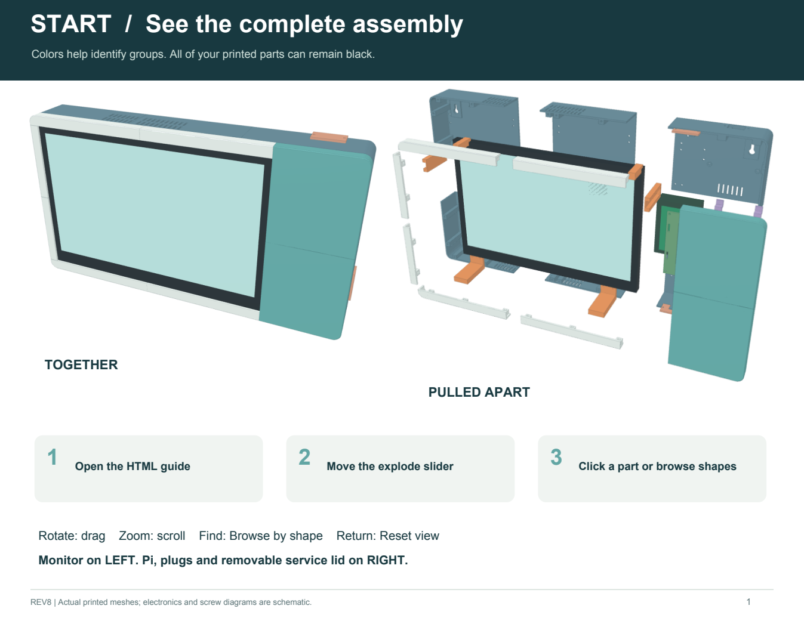
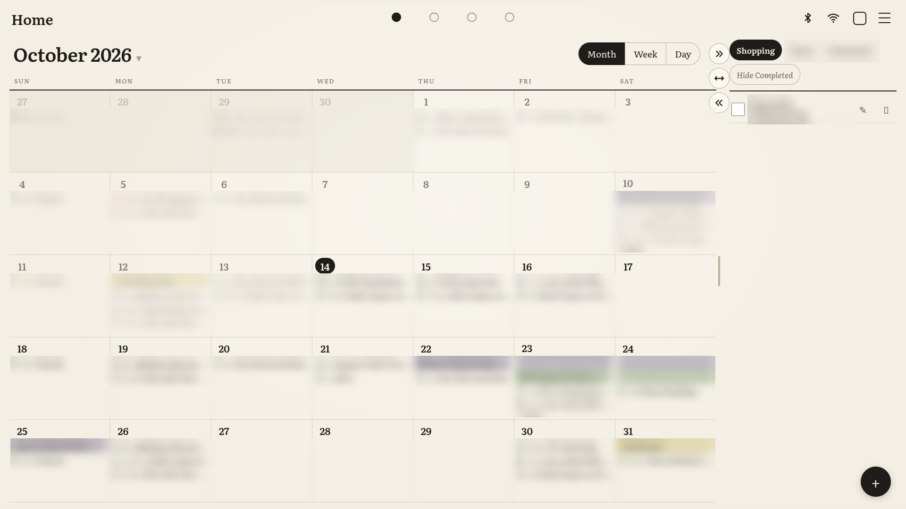
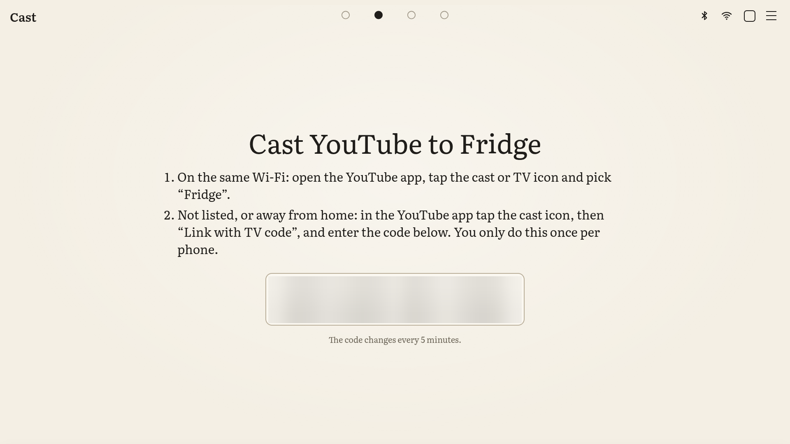
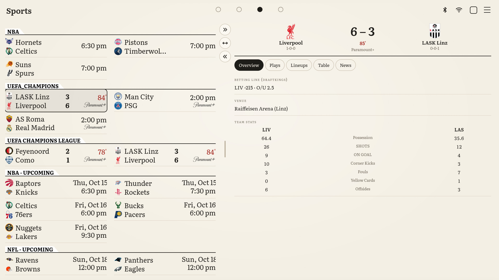
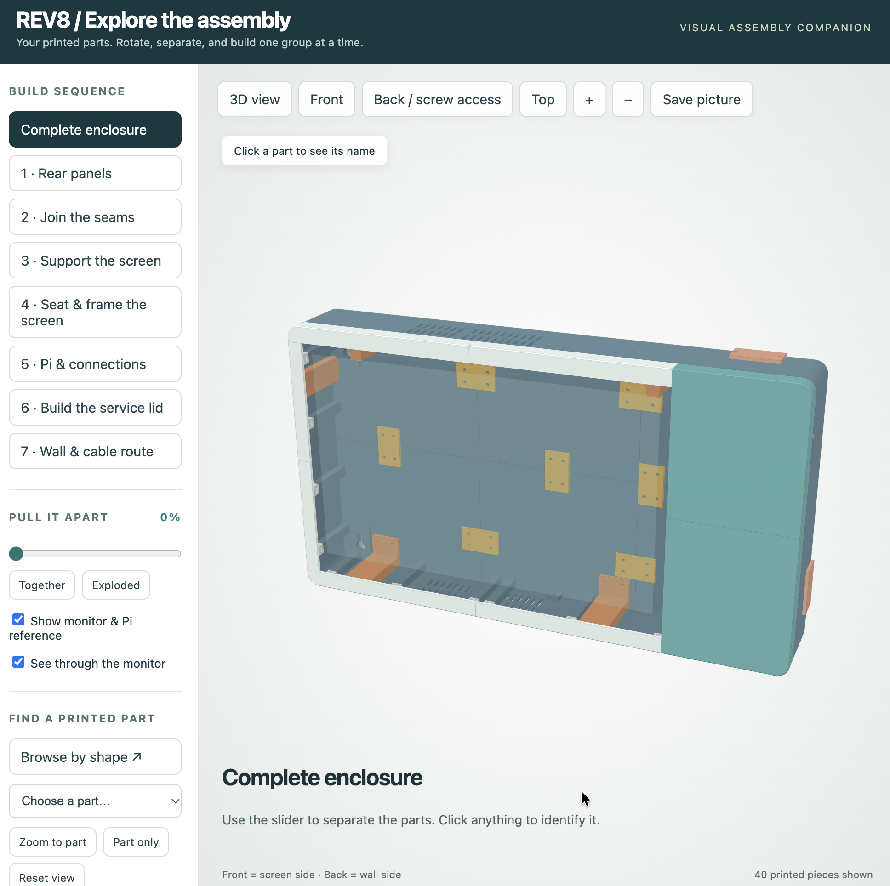

# Home Hub

A wall-mounted touch screen hub for the household, built on [MagicMirror²](https://github.com/MagicMirrorOrg/MagicMirror) and a Raspberry Pi 4, in a 3D printed enclosure.
Shared calendar, to-do lists, YouTube casting, live sports, a guest Wi-Fi QR code, and a Bluetooth speaker, all in a calm "paper" look that reads like an e-book instead of a glowing screen.

<!-- Photo to add: docs/images/hero.jpg (see docs/images/README.md). Uncomment the line(s) below once added. -->
<!--  -->



---

## Contents

- [What it does](#what-it-does)
- [Hardware](#hardware)
- [The enclosure (3D print)](#the-enclosure-3d-print)
- [Wiring and power](#wiring-and-power)
- [Software install](#software-install)
- [Configuration](#configuration)
- [Using it](#using-it)
- [How it is built](#how-it-is-built)
- [Design notes](#design-notes)
- [Known issues](#known-issues)
- [Troubleshooting](#troubleshooting)
- [License](#license)

---

## What it does

Three pages. Swipe or tap the dots at the top to move between them.

| Page | What you see |
|---|---|
| **Home** | A paper wall planner calendar (Month, Week and Day views) beside to-do lists with tabs. A drag divider sets the split. |
| **Cast** | Cast YouTube from any phone's YouTube app. The video plays full screen and the hub opens this page by itself. |
| **Sports** | Live scores for your teams, and a details panel for the game you tap: win chance, betting line, team stats, scoring plays, leaders or lineups, injuries, standings and news. |

On every page, the top bar has a Bluetooth speaker icon and a small network icon. Tap the network icon for a guest Wi-Fi QR code that visitors can scan to join.

| Home | Cast |
|---|---|
|  |  |
| **Sports** | |
|  | |

*Screenshots from the running hub. Personal calendar entries, to-do items and the cast code are blurred.*

A private admin page (reached over [Tailscale](https://tailscale.com) only) edits calendars, to-do tab names, sports teams and the guest Wi-Fi, from your phone.

<!-- Photo to add: docs/images/admin-page.png (see docs/images/README.md). Uncomment the line(s) below once added. -->
<!--  -->

---

## Hardware

| Part | Notes |
|---|---|
| Raspberry Pi 4 Model B | 4 GB recommended. Tested with Raspberry Pi OS (64-bit) trixie. |
| Raspberry Pi power supply, 5.1 V 3 A USB-C | Raspberry Pi recommends 3.0 A for the Pi 4. |
| microSD card, 32 GB or larger | Raspberry Pi recommends at least 32 GB for Raspberry Pi OS with the desktop. |
| INNOCN N1F Pro, 15.6" 1080p touch monitor | The enclosure is designed around this monitor. It has a Mini HDMI input, a "full-featured" USB-C port and a charging USB-C port. |
| The monitor's own 30 W USB-C PD power adapter | Comes with the monitor. See [Wiring and power](#wiring-and-power). |
| Externally powered USB hub (recommended) | For the touch connection. See [Wiring and power](#wiring-and-power). |
| Micro HDMI to Mini HDMI cable | Pi to monitor. |
| USB-A to USB-C cable | Touch, from the monitor's full-featured USB-C port. |
| Bluetooth speaker (optional) | Any speaker the Pi can pair with. |
| 3D printed enclosure and fasteners | See [The enclosure](#the-enclosure-3d-print). |

---

## The enclosure (3D print)

A wall mounted enclosure that hides the monitor, the Pi and all the cables, with a removable service lid over the Pi.

- **Print file:** [`hardware/home-hub-enclosure-REV8.3mf`](hardware/home-hub-enclosure-REV8.3mf) (Bambu Studio project, revision 8).
- **Printed on:** Bambu Lab P1S, 0.4 mm nozzle, PLA.
- **Size:** about 488 W x 270 H x 70 D mm, plus 8 mm wall spacers.
- **Parts:** 40 printed pieces: six rear tiles joined by splice plates, monitor supports, front trim, a Pi carrier, a two-piece service lid, wall spacers and cable exit inserts.
- **Fasteners:** mainly M3 bolts and nuts (48 x M3 x 12, 50 x M3 nuts) plus M3 screws for plastic. The full list is in the assembly guide.

Assembly guides, in [`hardware/assembly/`](hardware/assembly/):

| File | What it is |
|---|---|
| `REV8-Picture-Assembly-Guide.pdf` | Picture-first assembly sequence and a printable parts atlas. |
| `REV8-Assembly-Guide.pdf` | Short illustrated guide with the hardware list and tools. |
| `REV8-Interactive-Assembly.html` | Open in a desktop browser (no install). Rotate, explode the assembly, click a part to see its name, browse parts by shape. |



<!-- Photo to add: docs/images/print-parts.jpg, docs/images/build-inside.jpg (see docs/images/README.md). Uncomment the line(s) below once added. -->
<!--  -->
<!--  -->

The monitor and Pi in the assembly visuals are schematic references. The enclosure is licensed separately from the code (see [License](#license)).

---

## Wiring and power

What each manufacturer specifies:

- **Raspberry Pi 4:** recommended power supply 3.0 A. The total current for everything plugged into its USB ports is at most **1.2 A** at 5 V (about 6 W). For power-hungry USB devices, Raspberry Pi's advice is an externally powered USB hub. ([Raspberry Pi power supply documentation](https://www.raspberrypi.com/documentation/computers/raspberry-pi.html#power-supply))
- **INNOCN N1F Pro:** power input DC 20 V / 1.5 A over USB-C Power Delivery, up to **30 W**, with a 30 W PD adapter in the box. ([INNOCN N1F Pro specifications](https://innocn.com/en-us/products/refurbished-n1f-pro-15-6-1080p-touch-screen-portable-monitor))

So the Pi cannot power this monitor on its own. Wire it like this:

1. **Picture:** Pi micro HDMI to the monitor's Mini HDMI.
2. **Monitor power:** the monitor's 30 W adapter into its **charging** USB-C port.
3. **Touch:** the monitor's **full-featured** USB-C port to an externally powered USB hub, and the hub to the Pi. Use a black USB 2 port on the Pi; touch only needs USB 2.
4. **Pi power:** its own 5.1 V 3 A supply.

<!-- Photo to add: docs/images/wiring.jpg (see docs/images/README.md). Uncomment the line(s) below once added. -->
<!--  -->

Powering the monitor from the Pi's USB port causes short screen dropouts and under-voltage warnings on the Pi. See [Known issues](#known-issues).

---

## Software install

You need a Raspberry Pi 4 with **Raspberry Pi OS (64-bit) with desktop**, and a computer to flash the card.

1. **Flash the card** with [Raspberry Pi Imager](https://www.raspberrypi.com/software/). In its customisation settings, set the hostname (for example `homehub`), a user and password, your Wi-Fi, your time zone (calendar days use it), and turn **SSH** on.
2. **Copy this repository to the Pi.** Either from a Mac or Linux computer:
   ```bash
   ./scripts/deploy-to-pi.sh pi@homehub.local
   ```
   (copies the folder over SSH and runs the full install), or copy the folder to the Pi with a USB stick and, in a terminal on the Pi's desktop, run:
   ```bash
   cd ~/MagicMirrorCode && bash install.sh
   ```
   Use `bash install.sh`, not `sudo`; it asks for your password when it needs it. It installs Node 24 and Tailscale, MagicMirror v2.38.0, the pinned third party modules with this project's patches, the custom modules, the config and the services, and it sets desktop autologin and turns screen blanking off. The MagicMirror step is slow on a Pi (often 10+ minutes).
3. **Sign the Pi into Tailscale** once: `sudo tailscale up`, then open the link it prints. Install Tailscale on your phone with the same account.
4. **Add your calendar addresses** to `~/MagicMirror/config/config.env` (see [Calendars](#calendars)), or add them later on the admin page.
5. **Reboot:** `sudo reboot`. The Pi logs into the desktop and Home Hub starts full screen.
6. **Check:** `~/MagicMirrorCode/scripts/verify.sh`. Every line should say PASS.

To update later, from the computer: `./scripts/deploy-to-pi.sh pi@homehub.local --update`.

Logs: `journalctl --user -u magicmirror -f` and `journalctl --user -u mm-configbridge -f`.

### Replacing the SD card

Do this when the screen shows "SD card errors", `verify.sh` fails its SD card check, or the Pi stops starting. Do not reuse the old card or copy its files back wholesale: on a failing card the system files themselves are damaged.

1. **Save the data** from the old card on a Mac (read-only): `sudo bash scripts/save-pi-data.sh disk4 <pi-user>` (find the disk with `diskutil list`). It goes to `~/pi-saved-data`.
2. **Flash a new card**, 32 GB or larger, and install as in steps 1 to 3 above.
3. **Put the data back:** `bash scripts/restore-pi-data.sh <pi-user>@homehub.local`. Calendars, to-do lists, the admin page's settings and token, the cast pairing, the choice of Bluetooth speaker and the installer's backups come back. Pair the speaker once more from the speaker icon: Bluetooth keeps the pairing itself in its own storage (`/var/lib/bluetooth`), which the BlueZ project says not to edit from outside ([settings storage](https://bluez.readthedocs.io/en/latest/settings-storage/)), so the scripts leave it alone (decided by Claude, 2026-10-28).
4. **Tailscale:** the new install is a new Tailscale device, so the admin page's address changes. The installer prints it. Remove the old device in the Tailscale admin console.
5. **Check:** `~/MagicMirrorCode/scripts/verify.sh`.

---

## Configuration

### Calendars

Each calendar is a secret iCal address (Google Calendar > Settings > the calendar > "Secret address in iCal format"). Put them in `config.env` (`SECRET_CAL_FAMILY`, `SECRET_CAL_ME`, `SECRET_CAL_PARTNER`, ...) or add them later on the admin page. iCal addresses are passwords: they stay on the Pi and are masked on the admin page.

### Admin page

- Open `http://<pi-tailscale-ip>:8081/admin` from a phone or computer on your Tailscale network. The installer prints the address.
- The token is `BRIDGE_TOKEN` in `~/.config/mm-configbridge/bridge.env`. Paste it once per device.
- It listens only on the Pi's Tailscale address, never on your home network or the internet.
- You can edit: to-do tab names, calendars and their colors, the default calendar view, sports leagues and teams (searchable by team name), and the guest Wi-Fi.
- Every save is checked, backed up, applied, and rolled back automatically if MagicMirror does not come back.

### Secrets

- Keys and iCal addresses live only in `~/MagicMirror/config/config.env` (mode 600). MagicMirror never serves that file and replaces `SECRET_*` values before anything reaches the screen.
- The admin page's file `config.bridge.json` holds only placeholders.
- The guest Wi-Fi name and password are shown on the screen on purpose.
- Never commit `config.env`, `config.bridge.json` or `bridge.env`. The `.gitignore` excludes them.

---

## Using it

### Home: calendar and to-do

- **Month** (default): the real month with neighbouring days greyed and today circled. Multi-day events are a highlighter band; timed events show a dot, the time and the title.
- **Week** and **Day** views from the switch at the top.
- **Swipe** for the next or previous month. **Tap the title** for a month and year picker. **Tap a day** for its agenda, and an event for its details.
- After 2 minutes without a touch it returns to this month.
- **To-do:** tabs for each list (rename them on the admin page; their tasks follow). Add, tick, edit and delete with the on-screen keyboard.
- **Divider:** drag it to change the split, or use its buttons to expand either side.

### Cast

- On the same Wi-Fi: open the YouTube app on any phone, tap the cast icon and pick **Fridge** (the cast name; change `deviceName` for MMM-YouTubeCast in `config/config.js`). On iPhone, the YouTube app needs Local Network access.
- Not listed, or away from home: in the YouTube app, cast icon > "Link with TV code", and enter the code shown on the Cast page. Once per phone.
- Tap the video for Pause/Play and Stop. Stop on the screen also disconnects the phones.

### Bluetooth speaker

- Tap the Bluetooth icon, then **Find new speaker** (put the speaker in pairing mode first) and **Pair & connect**. All sound, casts included, then plays on the speaker.
- The speaker may go to sleep when idle. Home Hub wakes it when a cast starts or resumes.

### Sports

- Pick leagues and teams on the admin page. Games appear as a grid that fits the left side; drag the divider to make room.
- Tap a game for its details on the right. With nothing tapped, the panel follows a live game.

---

## How it is built

MagicMirror² provides the page framework. This project adds a config, a theme, patches to existing modules, and its own modules:

| Folder | What it is |
|---|---|
| `install.sh` | The installer, run on the Pi. Safe to re-run; `--update` redeploys only. |
| `modules.lock` | The third party modules, pinned to exact commits. |
| `patches/` | Fixes applied to those modules after checkout (see below). |
| `config/` | `config.js` (pages and modules), `custom.css` (the paper theme), the Literata font, and templates for `config.env` and the admin settings. |
| `modules/MMM-GameDetails` | The Sports page's details panel (ESPN game summaries). |
| `modules/MMM-YouTubeCast` | The YouTube cast receiver and Cast page. |
| `modules/MMM-BluetoothAudio` | The Bluetooth speaker icon and popup (BlueZ and PipeWire). |
| `modules/MMM-GuestNet` | The network icon and the guest Wi-Fi QR popup. |
| `modules/MMM-SplitLayout` | The drag dividers on Home and Sports. |
| `modules/MMM-TouchNav` | Page titles, swipe between pages, return to Home when idle. |
| `modules/MMM-Guard` | Restarts MagicMirror when the page or GPU process crashes or the page hangs, instead of leaving a frozen screen. Shows a warning strip when the SD card has errors, the power supply is too weak, or the disk is nearly full. |
| `config-bridge/` | The admin page server (Node, no npm dependencies). |
| `system/` | systemd user services and the desktop autostart hook. |
| `scripts/` | Deploy, verify, diagnostics, and SD card backup and restore helpers. |
| `hardware/` | The 3D printable enclosure and its assembly guides. |
| `tests/` | Unit tests: `node --test tests/*.test.js` |

### Patches

| Module | What the patch changes |
|---|---|
| MMM-MyGCalendar | The screen part is rewritten as the paper planner (Month, Week and Day, swipe, picker, agenda popup) that redraws in place and skips refreshes that change nothing. Fixes edited instances of recurring events west of UTC. Keeps a feed's last good copy if a download fails, and hides duplicate events across calendars. |
| MMM-TodoList | Fixes edits and deletes hitting the wrong task once a task was done, and the screen not refreshing. Pre-fills the keyboard when editing. Saves safely. Renamed tabs keep their tasks. |
| MMM-MyScoreboard | Tags each game with its ESPN id so the details panel can load it; lists a game between two followed teams once. |
| MMM-SmartTouch | Shutdown and restart use `sudo -n`. |

---

## Design notes

- **Paper look.** Warm paper, black ink and the Literata e-book typeface instead of the usual dark mirror style, so it reads like a printed planner. The Electron window is solid, not transparent.
- **Pages fill the screen** (`fullscreen_below`) rather than MagicMirror's centered regions, so popups and dividers work across the whole screen.
- **Secrets stay on the Pi.** No key is sent to the screen.
- **The admin page is Tailscale-only** and needs a token, with optional extra checks (allowed Tailscale users, HTTP basic auth).
- **systemd user services instead of pm2.** MagicMirror starts from the desktop session so it always has the display; the admin page runs separately so it keeps working even if a MagicMirror config is broken.
- **Casting** uses [yt-cast-receiver](https://github.com/patrickkfkan/yt-cast-receiver): YouTube app discovery on the same Wi-Fi, plus "Link with TV code" pairing.
- **Electron 44.5.1.** MagicMirror 2.38.0 ships Electron 44.4.5, which can flash and then blank the screen on Raspberry Pi OS trixie ([MagicMirror #4287](https://github.com/MagicMirrorOrg/MagicMirror/issues/4287)). The installer upgrades it; remove the pin once MagicMirror releases a version with 44.5.1.
- **Stay on Wayland (labwc).** Raspberry Pi's documentation advises against switching to X11, which is no longer developed ([Raspberry Pi configuration docs](https://www.raspberrypi.com/documentation/computers/configuration.html)).
- **No Globe page** (Emmanuel's decision, 2026-10-27: barely used). It held Google's 3D Earth, air quality and local news, and it was the only page that drew 3D graphics (WebGL). The Google browser key went with it. Its saved pins are in git history and in the SD card backup.
- **Recovering from freezes** (decided by Claude, 2026-10-26, after the Pi froze for over a day). Each layer catches a different failure; each is undone by removing one file.
  - *Hung kernel or system:* the Pi 4's hardware watchdog reboots it after 15 s without a response. Off by default in systemd ([systemd-system.conf](https://www.freedesktop.org/software/systemd/man/257/systemd-system.conf.html), `RuntimeWatchdogSec=`); 15 s is inside the Pi 4 watchdog's limit of about 16 s ([bcm2835_wdt.c](https://github.com/raspberrypi/linux/blob/rpi-6.12.y/drivers/watchdog/bcm2835_wdt.c)). File: `/etc/systemd/system.conf.d/90-mm-fridge-watchdog.conf`.
  - *Crashed, killed or hung screen while the Pi still runs:* MagicMirror 2.38 has no handler for this ([js/electron.js](https://github.com/MagicMirrorOrg/MagicMirror/blob/v2.38.0/js/electron.js)), so `MMM-Guard` exits on Electron's `render-process-gone`, a GPU `child-process-gone`, or 60 s of `unresponsive` ([Electron webContents](https://www.electronjs.org/docs/latest/api/web-contents), [app](https://www.electronjs.org/docs/latest/api/app)), and systemd restarts MagicMirror. Remove `{ module: "MMM-Guard" }` from `config.js` to undo.
  - *Failing SD card* (added 2026-10-28). What actually stopped the fridge: on 2026-10-25 the card corrupted the folder that holds the system's shared libraries (`/usr/lib/aarch64-linux-gnu`, unchanged since 10-12), the kernel counted 6.9 million file system errors over 34 hours, and after the power cycle the Pi could not start. Nothing on screen said so. `MMM-Guard` now checks every 10 minutes the kernel's ext4 error count (`/sys/fs/ext4/*/errors_count`), under-voltage (`vcgencmd get_throttled`, [Raspberry Pi docs](https://www.raspberrypi.com/documentation/computers/os.html)) and free space, and shows a strip at the bottom of every page when one fails; `verify.sh` checks the same. See [Replacing the SD card](#replacing-the-sd-card).
  - *No read-only system for now* (decided by Claude, 2026-10-28; not yet confirmed by Emmanuel). Raspberry Pi OS can lock the system files and keep every change in memory (raspi-config's overlay file system), but the files that broke were not being written to, everything the fridge keeps (to-do lists, settings, pairings, Tailscale, logs) would need a separate writable area, every update would need two restarts, and in May 2026 a kernel update left the overlay silently off ([raspi-config #306](https://github.com/RPi-Distro/raspi-config/issues/306); Raspberry Pi white paper [Making a more resilient file system](https://pip-assets.raspberrypi.com/categories/685-app-notes-guides-whitepapers/documents/RP-003610-WP-3-Making%20a%20more%20resilient%20file%20system.pdf), release 3, 2026-08-07). Instead: power the monitor separately if it still runs from the Pi's USB (see Known issues), use a well-known card brand, make saves fsync before renaming, and the health log's `card_write_mb` column to measure daily writes. Revisit if the card is written heavily or the power warning appears.
  - *Evidence for next time:* the system log is kept across reboots (Raspberry Pi OS otherwise keeps it in memory only), capped at 200 MB (`/etc/systemd/journald.conf.d/90-mm-fridge.conf`, [journald.conf](https://manpages.debian.org/trixie/systemd/journald.conf.5.en.html)), and `mm-health.service` writes memory, swap, GPU memory, temperature and throttling to `~/fridge-health.log` once a minute.

---

## Known issues

- **Short screen dropouts when the monitor is powered from the Pi.** The Pi can give its USB devices about 6 W in total, and the INNOCN N1F Pro is rated up to 30 W. A screen-capture test on the Pi showed its picture steady while the monitor dropped out, and the Pi logged under-voltage when the monitor was plugged in. Wire it as in [Wiring and power](#wiring-and-power).
- **The Pi 4's Bluetooth and 2.4 GHz Wi-Fi share one radio.** If casting to a Bluetooth speaker stutters, keep the speaker close or use 5 GHz Wi-Fi.

---

## Troubleshooting

| Problem | Try |
|---|---|
| Black screen after boot | `journalctl --user -u magicmirror -b`. If it says WAYLAND_DISPLAY is not set, check that `~/.config/labwc/autostart` has the `magicmirror kiosk` block, then reboot. |
| Screen dropouts or flicker | Check the power wiring first, then `vcgencmd get_throttled` (anything other than `throttled=0x0` means under-voltage has happened). `scripts/diagnose-display.sh` collects the usual checks. |
| "Cannot enable. Maybe the USB cable is bad?" at boot | The touch cable is in a blue USB 3 port and the monitor's USB 3 link fails. Move it to a black USB 2 port. |
| Admin page unreachable | `tailscale status` on the Pi, and `journalctl --user -u mm-configbridge`. |
| It froze or restarted by itself | After it is back: `journalctl -b -1 -p warning` (the boot before), `journalctl --user -u magicmirror -b -1 \| grep -i guard` (screen restarts), and `bash ~/.local/share/magicmirror/health-log.sh --summary` (memory and temperature by the hour, and how much was written to the SD card). |
| Back up before re-imaging the card | `scripts/save-pi-data.sh` copies keys and saved data off the SD card on a Mac, read-only; `scripts/restore-pi-data.sh` puts them back after a fresh install. See [Replacing the SD card](#replacing-the-sd-card). |
| Strip at the bottom: "SD card errors" | The card is failing. Replace it soon: [Replacing the SD card](#replacing-the-sd-card). |
| Strip at the bottom: "Power too weak" | Under-voltage happened since the last start. Use the Raspberry Pi 5.1 V 3 A supply and power the monitor separately ([Wiring and power](#wiring-and-power)), then reboot. |

---

## License

- **Code:** [MIT](LICENSE).
- **Enclosure and assembly documents** (`hardware/`): [CC BY-NC-SA 4.0](hardware/LICENSE.md). Print, share and remix with credit, not for commercial use.
- **Third party components** keep their own licenses: see [THIRD_PARTY_NOTICES.md](THIRD_PARTY_NOTICES.md).
